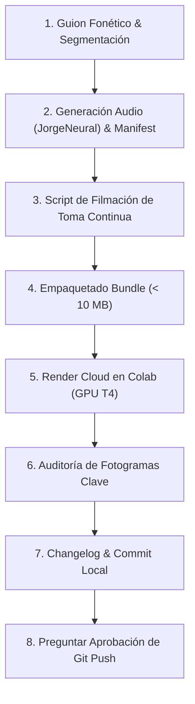

# 🎬 AsTrade Tutorial Video Production Skill

Esta habilidad encapsula todo el conocimiento técnico, estándares audiovisuales, lecciones aprendidas y procedimientos de control de calidad refinados durante la producción de los videos tutoriales de **AsTrade**.

---

## 🛡️ Las 7 Reglas de Oro Inquebrantables

1. **Renderizado 100% Cloud en Google Colab (GPU T4)**:
   - **NUNCA** renderices ni filmes videos localmente con Playwright o FFmpeg. En equipos con recursos limitados, el consumo de CPU y RAM llega al 100%, generando cuellos de botella y bloqueos.
   - Todo el proceso de filmación y renderizado se ejecuta en la máquina virtual remota de Google Colab mediante el script orquestador `run_colab_render_video_XX.py`.
2. **Arquitectura de 3 Escenas Limpias**:
   - **Escena 1 (Intro Cinemático, ~6.2s)**: `intro_outro_motion.html?mode=intro&tutorial=X` con locución del título leída por Jorge (*"Tutorial X: ..."*). Erradica fotogramas vacíos o pantallas sin cuentas.
   - **Escena 2 (Toma Continua en `app.html`, ~100-115s)**: Grabación en una sola toma sin cortes usando `window.__studioMotionEngine` (desplazamientos de cursor, clics, anillos de pulso y badges).
   - **Escena 3 (Outro Cinemático, ~10.8s)**: `intro_outro_motion.html?mode=outro&tutorial=X` con llamada a la acción hacia el dominio oficial `astradehub.com`.
3. **Estándar Zero-Blur Global (Cero Desenfoques)**:
   - **Prohibido** usar `backdrop-filter: blur(...)` o velos oscuros opacos sobre la interfaz.
   - Toda la pantalla debe permanecer 100% nítida y legible a 1080p. El foco visual se logra mediante anillos de pulso esmeralda (`#10b981`), callout badges flotantes y lower thirds.
4. **Fonética Dual Estricta (Audio con `es-ES-JorgeNeural`)**:
   - **Siglas habladas en español:** `TP` ➔ *"Té Pé"*, `Full TP` ➔ *"Full Té Pé"*, `BE` ➔ *"Bé E"*, `SL` ➔ *"Ese Ele"*.
   - **Nombres técnicos completos en inglés:** `Take Profit` ➔ */téik prófit/*, `Break Even` ➔ */bréik íven/*, `Stop Loss` ➔ */stóp los/*, `Market Buy` ➔ */Márket Bai/*, `Drawdown` ➔ */dróudaun/*.
5. **Realismo y Coherencia Institucional de Trading**:
   - **Horarios lógicos:** Sesión New York siempre a las `09:30 AM` (apertura de Wall Street), nunca de madrugada (ej. 02:46 AM).
   - **Concordancia DOM-Audio:** Si el audio dice *Market Buy*, el selector `#inputOrden` debe mostrar *Market Buy*. Si dice *A favor*, `#inputTendencia` debe marcar *Favor*.
   - **Cero números supersticiosos:** Nunca usar lotajes como **6.66** o **13**. Diseñar parámetros limpios (ej. SL 20 pips, TP 60 pips = **5.00 lotes** exactos con 1.0% de riesgo sobre $100K).
6. **Sincronización Matemática y Curva de Capital Continua**:
   - Pre-cargar cuentas con `balanceActual: null` para que AsTrade proyecte los trades dinámicamente.
   - Tras el cierre en Full TP (+3.00%), la gráfica debe dibujar una curva ascendente limpia de $100,000 a **$103,000 USD** (sin parábolas invertidas ni caídas a 100k) y el KPI de Retorno Total debe brillar en **+3.00%** verde esmeralda.
7. **Control de Versiones y Despliegue (`GEMINI.md`)**:
   - **NUNCA** ejecutar `git push` de forma autónoma.
   - Registrar la versión en `CHANGELOG.md` siguiendo el formato *Keep a Changelog*.
   - Realizar commit local, documentar qué se cambió, cómo probarlo y preguntar explícitamente: *¿Deseas que suba y despliegue estos cambios a producción?*

---

## 📋 Runbook de Producción Paso a Paso



---

### Paso 1: Guion y Segmentación Fonética
1. Redactar el guion dividido en **6 bloques funcionales** de ~15-25 segundos cada uno.
2. Aplicar la función `to_phonetic_spanish()` detallada en la [Guía Fonética](./references/audio_phonetics_guide.md).
3. Asegurar que los conceptos se enuncien **antes o simultáneamente** a la acción en pantalla.

### Paso 2: Generación de Audio y Manifest (`generate_video_XX_audio.py`)
1. Generar audios individuales por bloque con `edge-tts`:
   ```bash
   python scripts/audio/generate_video_XX_audio.py
   ```
2. Concatenar la pista continua de voz con silencios exactos (`scratch/video_XX/audio/video_XX_continuous_voice.mp3`).
3. Generar el archivo de sincronización `manifest.json` con los timestamps `start_seconds`, `duration_seconds` y `cumulative_end` de cada bloque.

### Paso 3: Script de Filmación (`render_video_XX_astrade.py`)
1. Implementar la arquitectura de 3 escenas:
   - `record_intro`: 6.2s con `intro_outro_motion.html?mode=intro&tutorial=X`.
   - `record_app_flow_continuous`: Toma continua en `app.html` con duración exacta del audio continuo.
   - `record_outro`: 10.8s con `intro_outro_motion.html?mode=outro&tutorial=X`.
2. **Pre-inicialización DOM obligatoria**:
   ```javascript
   await dbSet('trading_journal_real_accounts', [account]);
   await dbSet('trading_journal_data', []);
   realAccounts.length = 0;
   realAccounts.push(account);
   await loadDataForMode();
   renderGroups(); // Tarjetas visibles desde el primer frame
   ```
3. Ensamblar con FFmpeg mediante filtro `xfade=transition=fade` de 0.5s y música atenuada (*ducking* a 0.065).

### Paso 4: Empaquetado de Bundle Cloud (`package_video_XX_bundle.py`)
1. Ejecutar el empaquetador para generar `astrade_videoXX_bundle.zip` (< 10 MB).
2. Consultar las reglas de inclusión y exclusión en el [Pipeline Cloud](./references/colab_cloud_pipeline.md).

### Paso 5: Orquestación Cloud en Google Colab (`run_colab_render_video_XX.py`)
1. Iniciar el renderizado en la nube:
   ```bash
   python scripts/cloud/run_colab_render_video_XX.py
   ```
2. El orquestador aprovisiona `colab new -s astrade-render-vX --gpu T4`, sube el bundle, ejecuta `remote_runner_video_XX.py`, descarga el video final a `media/youtube_tutorials/AsTrade_Tutorial_XX_1080p.mp4` y apaga la máquina remota automáticamente.

### Paso 6: Auditoría de Fotogramas Clave
1. Extraer fotogramas en hitos clave con FFmpeg:
   - `01_intro_title.png` (t ≈ 3.0s): Título legible y animado.
   - `02_account_ready.png` (t ≈ 8.0s): Tarjeta de cuenta precargada (cero pantallas vacías).
   - `03_modal_setup.png`: Hora 09:30 AM, tendencia Favor, orden Market Buy.
   - `04_modal_risk_lots.png`: SL 20, TP 60, R:R 3.00, lotaje 5.00 lotes (sin 6.66 ni 13).
   - `05_nav_journal.png`: Desplazamiento visible a Registro de Trades antes de editar.
   - `06_dashboard_curve.png`: Curva ascendente a $103,000 USD y Retorno Total en +3.00%.
   - `07_goals.png`: Target al 37.5%, Drawdown 100% intacto.
2. Inspeccionar visualmente cada fotograma con la herramienta `read_file`.

### Paso 7: Empaquetado de YouTube (Miniatura 1080p, Metadatos SEO y Capítulos)
1. **Generación de Carátula Minimalista Técnica:**
   - Ejecutar `python scripts/render/generate_youtube_thumbnails.py` para compilar la miniatura en 1920x1080 Full HD con mockup nítido de la interfaz y branding oficial.
2. **Generación de Metadatos y Capítulos:**
   - Crear `media/youtube_tutorials/packages/tutorial_XX/metadata.md` con título optimizado para CTR, descripción estructurada con marcas de tiempo, enlaces oficiales a `astradehub.com` y etiquetas.
3. **Validación Previa con Dry-Run:**
   - Ejecutar `python scripts/social/upload_youtube.py --tutorial XX --dry-run` para validar que el video, la miniatura y los textos están listos.

### Paso 8: Documentación, Control de Versiones y Publicación
1. Crear el artefacto `WALKTHROUGH_VIDEO_XX.md` con la evidencia fotograma por fotograma.
2. Actualizar `CHANGELOG.md` con la versión semántica correspondiente.
3. Crear el commit local:
   ```bash
   git add CHANGELOG.md scripts/ ...
   git commit -m "feat(tutorial-XX): ..."
   ```
4. **Preguntar al usuario:** *¿Deseas que suba y despliegue estos cambios a producción (`git push origin main`)?*
5. Tras aprobación, ejecutar la subida a YouTube mediante `python scripts/social/upload_youtube.py --tutorial XX --privacy public` (o `--privacy unlisted`).

---

## 📚 Documentación de Referencia

- [Guía Fonética y Locución de Audio](./references/audio_phonetics_guide.md)
- [Pipeline de Renderizado en Google Colab (GPU T4)](./references/colab_cloud_pipeline.md)
- [Estándares Visuales y Motion Graphics (Zero-Blur)](./references/visual_motion_standards.md)
- [Reglas de Realismo y Coherencia en Trading](./references/trading_realism_rules.md)
