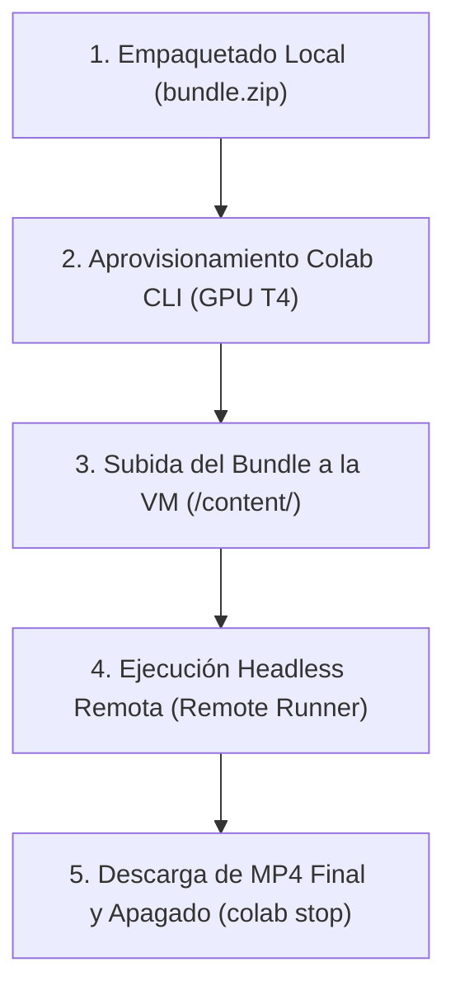

# ☁️ Pipeline de Renderizado en la Nube (Google Colab GPU T4)

Esta guía documenta la arquitectura obligatoria de ejecución remota para la filmación y renderizado de videos tutoriales de **AsTrade**, diseñada para evitar cuellos de botella de CPU/RAM en la computadora del usuario.

---

## 1. Justificación y Mandato Técnico

> [!CAUTION]
> **Prohibido Renderizar Localmente con Playwright + FFmpeg:**
> La filmación con captura de pantalla a 60 FPS y la codificación de video mediante FFmpeg saturan al 100% la CPU y la memoria RAM de computadoras de generaciones anteriores, generando cuellos de botella de hasta 7+ horas sin finalizar o bloqueos completos del sistema operativo.
> **Todo video debe compilarse al 100% en la nube mediante Google Colab CLI.**

---

## 2. Flujo de Trabajo en 5 Fases



---

## 3. Patrón de Empaquetado Local (`package_video_XX_bundle.py`)

El archivo comprimido debe ser ultra ligero (típicamente entre 6 MB y 9 MB) para subir a la VM en menos de 10 segundos:

```python
# Archivos y carpetas obligatorias:
INCLUDE_FILES = ["index.html", "app.html", "CHANGELOG.md"]
INCLUDE_DIRS = [
    "css",
    "js",
    "media/videoX_assets",
    "media/video1_assets/music",
    "scratch/video_XX/audio",
    "scripts/render"
]

# Exclusiones estrictas para evitar inflar el zip:
EXCLUDE_PATTERNS = [
    ".git", "__pycache__", "node_modules", ".venv", ".gemini",
    "scenes_raw", "recordings", ".mp4", ".webm", ".pyc"
]
```

---

## 4. Orquestador Local (`run_colab_render_video_XX.py`)

Comandos del CLI de Colab ejecutados por el orquestador:

1. **Aprovisionar máquina con acelerador T4**:
   ```powershell
   colab new -s astrade-render-vX --gpu T4
   ```
2. **Subir bundle comprimido**:
   ```powershell
   colab upload -s astrade-render-vX astrade_videoXX_bundle.zip /content/astrade_videoXX_bundle.zip
   ```
3. **Ejecutar runner remoto**:
   ```powershell
   colab exec -s astrade-render-vX -f scripts/cloud/remote_runner_video_XX.py --timeout 0
   ```
4. **Descargar video renderizado**:
   ```powershell
   colab download -s astrade-render-vX /content/trading-saas/media/youtube_tutorials/AsTrade_Tutorial_XX_1080p.mp4 ./media/youtube_tutorials/AsTrade_Tutorial_XX_1080p.mp4
   ```
5. **Apagar y liberar sesión**:
   ```powershell
   colab stop -s astrade-render-vX
   ```

---

## 5. Configuración del Entorno Remoto en la VM (`remote_runner_video_XX.py`)

La VM de Colab requiere las siguientes librerías de sistema para ejecutar Chromium en modo headless con audio y WebGL:

```bash
apt-get update -qq
apt-get install -y -qq ffmpeg xvfb libasound2 libgbm1
pip install -q playwright imageio-ffmpeg mutagen
playwright install chromium
playwright install-deps chromium
```

El script lanza `render_video_XX_astrade.py` dentro de `/content/trading-saas/`, garantizando una velocidad de filmación de ~2.5x en tiempo real gracias a la aceleración por hardware de la GPU T4.
