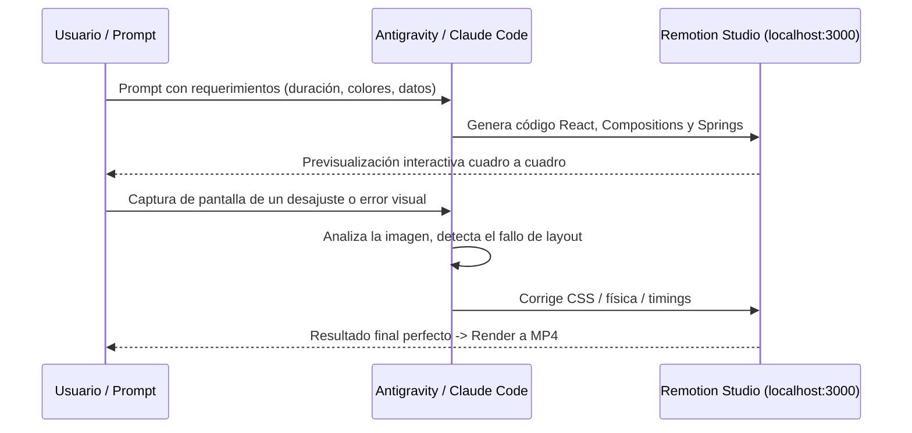

# 🎬 Remotion + AI: Programmatic Animation & Video Automation Skill

> *"La Inteligencia Artificial es creativa, pero Remotion es consistente."*
>
> A diferencia de los modelos generativos de video (Sora, Kling, Veo 3) que arrojan resultados aleatorios e irrepetibles en cada prompt, **Remotion** renderiza videos como código React puro. Cada elemento, temporización, física de rebote (`spring`) y transición es determinista, milimétrico y 100% reutilizable. Diseñas la animación una sola vez y puedes generar cientos de versiones intercambiando datos, textos, colores o audios.

---

## 1. Principios Fundamentales del Renderizado Programático

Para que un agente de IA y Remotion trabajen en perfecta sintonía, cada composición debe cumplir estas reglas estrictas:

1. **Determinismo Absoluto (Función Pura del Frame):**
   - Todo lo que cambia en pantalla debe ser una función matemática directa de `frame = useCurrentFrame()`.
   - **Prohibido:** `Date.now()`, `setInterval`, `setTimeout`, `Math.random()` no determinista (usar números pseudoaleatorios basados en el índice del frame o semilla fija) o llamadas de red asíncronas (`fetch`) dentro del cuerpo del componente.
2. **Física Natural con `spring()` en lugar de curvas estáticas:**
   - Usar `spring({ frame, fps, config: { damping, mass, stiffness } })` para apariciones elásticas, rebotes de texto, medidores y barras de progreso.
3. **Mapeo Gradual con `interpolate()`:**
   - Para transiciones fluidas de opacidad, desplazamiento `translateY`, escalas y rotaciones con `extrapolateLeft: 'clamp'` y `extrapolateRight: 'clamp'`.
4. **Desacoplamiento Total de Datos vs. Vista:**
   - Mantener los datos (métricas de trading, listas de jugadores, balances, textos) en archivos JSON o props dentro de `assets/` o `src/data/`. Para crear un nuevo video, solo se actualiza el archivo de datos sin tocar la lógica visual.
5. **Composición Modular con `<Sequence>` y `<Series>`:**
   - Dividir videos largos o tutoriales en escenas independientes:
     - Escena 1: Intro / Gancho
     - Escena 2: Desarrollo / Demostración / Datos
     - Escena 3: Conclusión / Outro / Call-To-Action (CTA)

---

## 2. Inicialización y Entorno de Trabajo

### Instalación Rápida
```bash
# Crear proyecto Remotion limpio con Tailwind CSS
npx create-video@latest --template blank-tailwind
# O iniciar con npm
npm init video
```

### Comandos de Ejecución
- **Visualizador en Vivo (Remotion Studio):**
  ```bash
  npm run dev
  # Abre el estudio interactivo en http://localhost:3000
  ```
  *Permite desplazarse cuadro a cuadro por la línea de tiempo, probar props y verificar el diseño antes de renderizar.*

- **Renderizado Final a MP4:**
  ```bash
  # Renderizar composición principal
  npx remotion render <CompositionId> out/video.mp4

  # Renderizar para YouTube Shorts / Reels (Vertical 1080x1920)
  npx remotion render <CompositionId> out/short.mp4 --props='{"aspectRatio":"vertical"}'

  # Renderizar en 4K Ultra HD
  npx remotion render <CompositionId> out/video_4k.mp4 --scale=2
  ```

---

## 3. Arquitectura del Código Remotion

### 3.1 Declaración del Root (`src/Root.tsx`)
```tsx
import { Composition } from 'remotion';
import { MainVideo } from './MainVideo';
import { IntroAnimada } from './components/IntroAnimada';
import { OutroAnimada } from './components/OutroAnimada';
import './style.css';

export const RemotionRoot: React.FC = () => {
  return (
    <>
      {/* Video Completo Horizontal (16:9) */}
      <Composition
        id="MainVideo"
        component={MainVideo}
        durationInFrames={30 * 60} // 60 segundos a 30 fps
        fps={30}
        width={1920}
        height={1080}
        defaultProps={{
          brandName: "AsTrade",
          brandUrl: "astradehub.com",
        }}
      />

      {/* Intro Institucional Independiente (5s) */}
      <Composition
        id="Intro"
        component={IntroAnimada}
        durationInFrames={30 * 5}
        fps={30}
        width={1920}
        height={1080}
      />

      {/* Outro / Despedida (6s) */}
      <Composition
        id="Outro"
        component={OutroAnimada}
        durationInFrames={30 * 6}
        fps={30}
        width={1920}
        height={1080}
      />
    </>
  );
};
```

---

### 3.2 Patrones de Animación Esenciales

#### A. Entrada con Resorte Elástico (`spring`)
```tsx
import { useCurrentFrame, useVideoConfig, spring } from 'remotion';

export const PopCard: React.FC<{ children: React.ReactNode }> = ({ children }) => {
  const frame = useCurrentFrame();
  const { fps } = useVideoConfig();

  const scale = spring({
    frame,
    fps,
    config: {
      damping: 12,    // Menor amortiguación = más rebote
      mass: 0.5,      // Peso del elemento
      stiffness: 100, // Rigidez del resorte
    },
  });

  const opacity = spring({
    frame,
    fps,
    config: { damping: 20 },
  });

  return (
    <div
      style={{
        transform: `scale(${scale})`,
        opacity,
      }}
    >
      {children}
    </div>
  );
};
```

#### B. Barra de Progreso o Crecimiento de Métricas (`interpolate`)
```tsx
import { useCurrentFrame, interpolate } from 'remotion';

export const AnimatedProgressBar: React.FC<{ targetPct: number }> = ({ targetPct }) => {
  const frame = useCurrentFrame();

  // De frame 10 al 40, la barra crece de 0% al targetPct
  const progress = interpolate(frame, [10, 40], [0, targetPct], {
    extrapolateLeft: 'clamp',
    extrapolateRight: 'clamp',
  });

  return (
    <div className="w-full bg-gray-800 h-4 rounded-full overflow-hidden border border-gray-700">
      <div
        className="h-full bg-gradient-to-r from-emerald-500 to-teal-400 rounded-full"
        style={{ width: `${progress}%` }}
      />
    </div>
  );
};
```

#### C. Sonido y Efectos de Audio (`<Audio>`)
```tsx
import { Audio, staticFile } from 'remotion';

export const SceneWithAudio: React.FC = () => {
  return (
    <>
      {/* Música de fondo atenuada */}
      <Audio
        src={staticFile('music/ambient_beats.mp3')}
        volume={(f) => interpolate(f, [0, 30, 270, 300], [0, 0.25, 0.25, 0])}
      />

      {/* Efecto de impacto / pop en el frame 15 */}
      <Audio
        src={staticFile('sfx/pop.mp3')}
        startFrom={0}
        volume={0.8}
        // Iniciar en el frame 15 usando Sequence
      />
    </>
  );
};
```

---

## 4. Los 4 Casos de Uso Maestros Demostrados

### Caso 1: Infografía / Tabla de Clasificación Dinámica (Top 10)
- **Concepto:** Presentar ránkings, tablas de rendimiento de traders, o listas de posiciones.
- **Técnica:** Desplegar elementos secuencialmente con `delay = index * 10` frames. Cada barra y avatar hace un `spring` suave de izquierda a derecha.
- **Reutilización:** Cambiar el JSON de jugadores/traders genera automáticamente una nueva infografía 4K lista para publicar.

### Caso 2: Animaciones de Bucle Viral / Simulaciones de Física (Estilo Hypnoz)
- **Concepto:** Juegos cinemáticos, esferas rebotando en anillos giratorios, cuentas regresivas y medidores de tensión.
- **Técnica:**
  - Simulación matemática paso a paso en cada frame (`angle = frame * speed`).
  - Sincronización de efectos de sonido (`pop`, `ding`, `laser`) exactamente en el fotograma de colisión.
  - Mensajes condicionales en el desenlace (`¡ÉXITO!` o `FALLO`).

### Caso 3: Subtítulos Dinámicos de Alto Impacto (Estilo Shorts / Reels / CapCut)
- **Concepto:** Subtítulos palabra por palabra con resaltado activo para retener el 100% de la atención del espectador.
- **Técnica:**
  - Obtener transcripción con marcas de tiempo a nivel de palabra usando Whisper:
    `[{ word: "AsTrade", start: 0.12, end: 0.45 }, ...]`
  - Agrupar en bloques de máximo 2 o 3 palabras por pantalla.
  - Aplicar un destello esmeralda neón o amarillo (`#10b981` / `#facc15`) y un salto de escala (`scale: 1.15`) en la palabra que coincide con el audio actual.

### Caso 4: Reportes Financieros y Métricas de Negocio (Multi-Escena)
- **Concepto:** Convertir estadísticas complejas, balances de trading y curvas de equidad en una presentación ejecutiva fluida.
- **Técnica:**
  - Encadenar escenas con `<Series>`:
    ```tsx
    <Series>
      <Series.Sequence durationInFrames={120}>
        <SceneKpiOverview data={reportData.kpis} />
      </Series.Sequence>
      <Series.Sequence durationInFrames={180}>
        <SceneEquityCurve trades={reportData.trades} />
      </Series.Sequence>
      <Series.Sequence durationInFrames={90}>
        <SceneMonthlyHeatmap monthly={reportData.monthly} />
      </Series.Sequence>
    </Series>
    ```

---

## 5. El Bucle de Trabajo Multimodal con Antigravity

El flujo de creación y corrección visual asistido por IA enseñado en el video se basa en este ciclo de retroalimentación:



### Reglas de Prompting para el Agente:
1. **Especificar siempre resolución y aspecto:** `"1920x1080 30fps landscape"` o `"1080x1920 30fps vertical Shorts"`.
2. **Definir la duración exacta en segundos o frames:** `"Duración de 10 segundos (300 frames a 30fps)"`.
3. **Indicar la fuente de datos:** `"Usa los datos de trading en scratch/data/accounts.json"`.
4. **Pedir corrección con imagen:** Si una animación se desborda o se ve desalineada, capturar el fotograma con `read_file` y pedir el ajuste directo en el código React.

---

## 6. Checklist de Entrega para Producción

- [ ] ¿El video es 100% determinista sin llamadas asíncronas no controladas ni fechas dinámicas?
- [ ] ¿Todas las apariciones usan `spring()` o `interpolate()` con límites `clamp`?
- [ ] ¿Los assets estáticos (logos, iconos, audios) se cargan mediante `staticFile()`?
- [ ] ¿El texto clave se mantiene dentro de los márgenes de seguridad (Title-safe 80%, Action-safe 90%)?
- [ ] ¿Los audios y efectos de sonido tienen controles de volumen suaves para evitar saturación o cortes bruscos?
- [ ] ¿El comando `npx remotion render` compila sin advertencias de dependencias?
